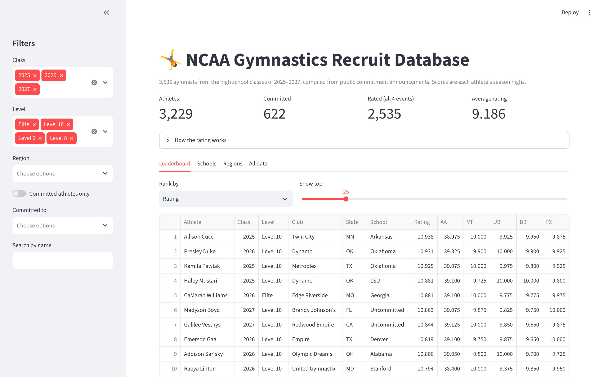

# 🤸 NCAA Gymnastics Recruit Database

**Live app:** https://gymnastics-recruits-ohrtqszxjbcf5voognscce.streamlit.app/

Football has recruiting databases, where fans and coaches can view stats about recruitable athletes. Gymnastics didn't have one, so I made it :)


## What it does

- **Leaderboard:** rank athletes by rating, all-around, or any single event, filtered by class, level, region, school or name
- **Schools:** which programs have the most commits, and the average rating of each class
- **Regions:** how ratings are distributed across the eight USA Gymnastics regions and internationally
- **Export:** download any filtered view as a CSV

## The rating

```
rating = mean(vault, bars, beam, floor season highs) + 1 if any event is a perfect 10.0
```

- **Event highs, not one meet's all-around.** Athletes rarely hit their best on all four events at the same meet, so event highs compare them more fairly.
- **Missing events stay unrated.** An athlete without a score on every event gets no rating, instead of a 0 that would rank them unfairly low. That covers 2,594 of 3,536 athletes.
- **The perfect-10 bonus is deliberately big.** A 10.0 is rare (17 athletes), and the bonus puts them at the top. The Regions chart shows the tradeoff: those athletes stand apart from everyone else. A smaller or per-event bonus would be a natural next experiment.

## How the data is built

`clean.py` turns the three raw class spreadsheets in `data/raw/` into `data/recruits.csv`:

1. Splits `"WOGA (TX)"` into club and state, and `"10-2024"` into level and season
2. Normalizes messy level codes (`10`, `E`, `XSA`, `C-FR`, `Retired 2024`, `TF`…) into Elite, Level 8–10, Xcel, College, Retired and Other sport
3. Parses regions (`R1`–`R8`) and international entries (`I-Canada` → Canada)
4. Treats a score of 0 as "didn't compete," and clears rows where the source spreadsheet's columns are misaligned (an event score above 10 or an all-around above 40)
5. Computes the rating and a committed/uncommitted flag

**Privacy:** most of these athletes are minors. The dataset holds only what's needed for rankings (name, club, state, region, level, school and scores), with no birth dates or social media handles. A test fails if either ever shows up.

## Project structure

```
app.py                  Streamlit dashboard
clean.py                Data cleaning and rating
data/raw/               Source spreadsheets, one per graduation class
data/recruits.csv       Cleaned dataset (generated by clean.py)
tests/test_clean.py     Tests for parsing, rating rules and data freshness
notebooks/explore.ipynb Exploratory charts (ratings by region and school)
```

## Run it locally

```bash
pip install -r requirements.txt
streamlit run app.py
```

To rebuild the data after editing a raw file, and run the tests:

```bash
python clean.py
pip install -r requirements-dev.txt
pytest
```

GitHub Actions runs the tests on every push. A second workflow pings the live app every four hours so Streamlit doesn't put it to sleep.

## Tech

Python · pandas · Streamlit · Plotly · pytest · GitHub Actions

## Data

Compiled from public commitment announcements and meet results. Scores are each athlete's season highs as reported, so they can be incomplete or out of date. Spot an error? Open an issue.
